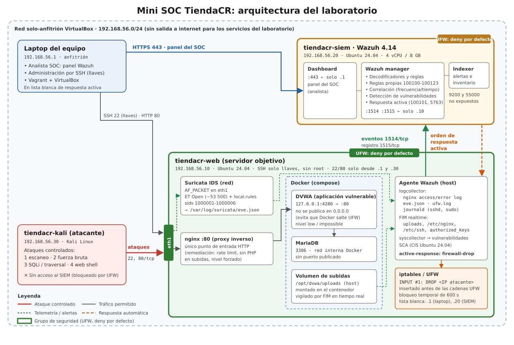

# Mini SOC TiendaCR

Proyecto 2 – ITI-922 Seguridad de TI II. Laboratorio local en VirtualBox, aprovisionado con Vagrant.

**Integrantes:** _Nombre Apellido 1_ · _Nombre Apellido 2_

> Estado del proyecto y lista de revisión: ver [`PENDIENTES.md`](PENDIENTES.md).

## Arquitectura



| VM | IP | Recursos | Contenido |
|---|---|---|---|
| `tiendacr-siem` | 192.168.56.20 | 4 vCPU, 8 GB | Wazuh 4.14 all-in-one (indexer, manager y dashboard) |
| `tiendacr-web` | 192.168.56.10 | 2 vCPU, 4 GB | DVWA en Docker, nginx (proxy), Suricata y agente Wazuh |
| `tiendacr-kali` | 192.168.56.30 | 2 vCPU, 4 GB | Kali Linux (máquina atacante) |

- Red solo-anfitrión `192.168.56.0/24`; la laptop es `192.168.56.1`.
- El grupo de seguridad se implementa con UFW en cada servidor, con denegación por defecto (ver `docs/2.2-control-de-acceso.md`).

## Requisitos

- VirtualBox 7.x y Vagrant 2.4.x.
- Unos 16 GB de RAM libres y 40 GB de disco.
- Conexión a internet durante el aprovisionamiento.

## Puesta en marcha

```bash
vagrant up siem        # 15-25 min (instala Wazuh)
vagrant up target      # 5-10 min (DVWA, nginx, Suricata y agente)
vagrant up attacker    # Kali (no arranca sola con "vagrant up")
```

| Servicio | URL | Credenciales |
|---|---|---|
| Panel Wazuh | https://192.168.56.20 | Usuario `admin`. Clave: `vagrant ssh siem -c "sudo cat /root/wazuh-passwords.txt"` |
| TiendaCR (DVWA) | http://192.168.56.10 | Las credenciales por defecto de DVWA. Nivel de seguridad inicial: `low`. |

Acceso SSH a las VM: `vagrant ssh <siem|target|attacker>`. Solo se aceptan llaves; no hay contraseñas ni acceso de root.

## Estructura

```
Vagrantfile                      Definición de las 3 VM
provision/common.sh              Endurecimiento de SSH y UFW con denegación por defecto (siem y target)
provision/siem.sh                Instalación de Wazuh y reglas de firewall del SIEM
provision/target.sh              DVWA, nginx, Suricata, agente Wazuh y reglas de firewall del objetivo
config/dvwa/compose.yml          Contenedores DVWA y MariaDB (publicados solo en 127.0.0.1)
config/nginx/tiendacr.conf       Proxy inverso y access log para Wazuh
config/suricata/local.rules      Reglas propias de Suricata
config/wazuh-agent/              Configuración adicional del agente (localfiles y FIM)
config/wazuh-manager/            Reglas propias de Wazuh y respuesta activa (firewall-drop)
provision/siem-rules.sh          Despliega las reglas de Wazuh y la respuesta activa (--provision-with rules)
provision/target-rules.sh        Despliega las reglas de Suricata (--provision-with rules)
provision/remediation.sh         Alterna entre el estado vulnerable y el remediado (2.8)
config/nginx/tiendacr-remediado.conf  nginx remediado: nivel impossible forzado, rate limit, sin PHP en subidas
scripts/alertas-ataque.py        Evidencia de detección: primera alerta por regla y tiempo hasta la alerta (2.4)
docs/                            Documentación por sección del enunciado
docs/arquitectura.svg|png        Diagrama de arquitectura (PNG para el informe)
evidencias/                      Capturas (con IP públicas e identificadores difuminados)
```

## Verificación rápida

```bash
vagrant ssh siem   -c "sudo /var/ossec/bin/agent_control -l"   # tiendacr-web debe estar Active
curl http://192.168.56.10/prueba-ids-tiendacr                  # genera la alerta de prueba (sid 1000000)
vagrant ssh target -c "sudo ufw status verbose"
```

## Actualizar reglas

```bash
vagrant provision target --provision-with rules   # Suricata (config/suricata/local.rules)
vagrant provision siem   --provision-with rules   # Wazuh (config/wazuh-manager/)
```

## Remediación (antes / después, punto 2.8)

```bash
vagrant provision target --provision-with vulnerable   # estado original (línea base de los ataques)
vagrant provision target --provision-with remediate    # controles C1-C5 aplicados
```

## Seguridad del repositorio

- Ninguna credencial se versiona.
- Las claves de Wazuh (`/root/wazuh-passwords.txt`) y de la base de datos de DVWA (`/opt/dvwa/.env`) se generan **dentro** de las VM.
- El `.gitignore` excluye `.vagrant/`, los archivos `.env`, las llaves y los archivos de contraseñas.

## Informe técnico (PDF)

El informe se arma desde `informe/secciones/` (versiones condensadas para el PDF) y `docs/fase1-investigacion.md`.
Los datos de la portada y el nombre del PDF se configuran en el bloque `CONFIG` de `informe/build.py`.

```bash
python3 -m venv .venv && .venv/bin/pip install markdown-it-py mdit-py-plugins weasyprint
.venv/bin/python informe/build.py      # -> informe/P1_Zamora_Saborio.pdf
```

El script informa el número de páginas (límite: 20) y cuántas marcas `COMPLETAR` quedan pendientes.

## Limpieza

```bash
vagrant destroy -f
```
